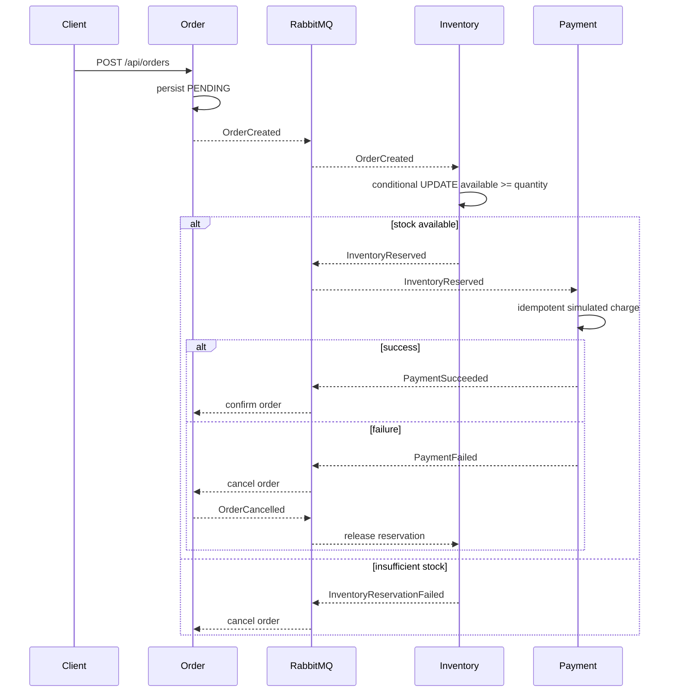

# Commerce Orchestrator checkout and compensation flow

Duplicate events are ignored by event ID. Stock reservation is an atomic SQL update, so concurrent requests cannot take availability below zero. A crash between a local commit and publish remains possible because an outbox is not implemented.
