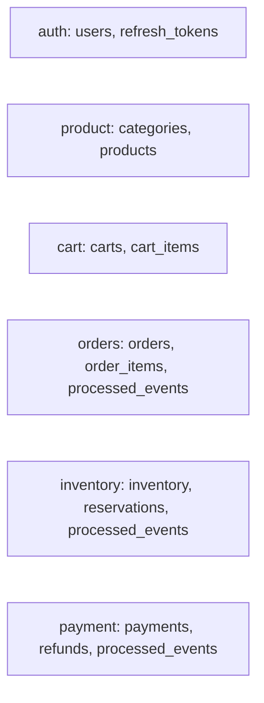

# Commerce Orchestrator data ownership

One PostgreSQL container reduces laptop memory use while Flyway and schema permissions express service ownership. Foreign keys exist only within a service boundary. UUID primary keys support decentralized creation. Unique constraints protect email, SKU, one cart per user, reservation identity, one payment per order, and idempotency keys. Search/history columns are indexed. Money uses `NUMERIC(12,2)`/`BigDecimal`.
