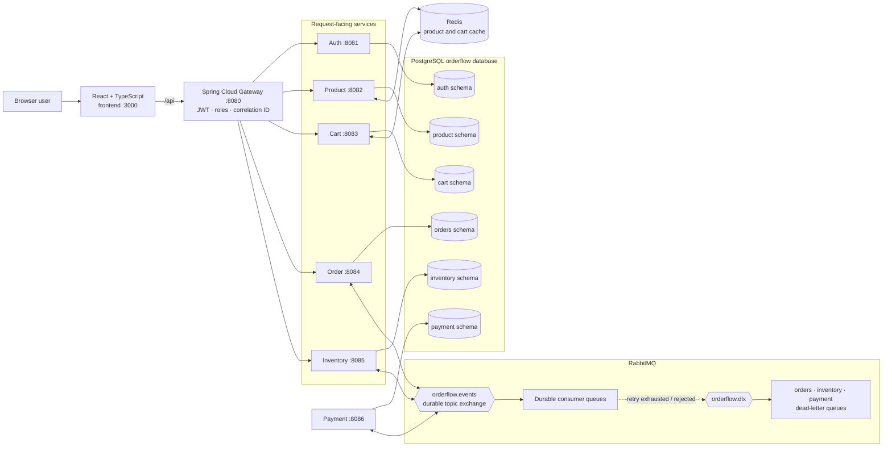
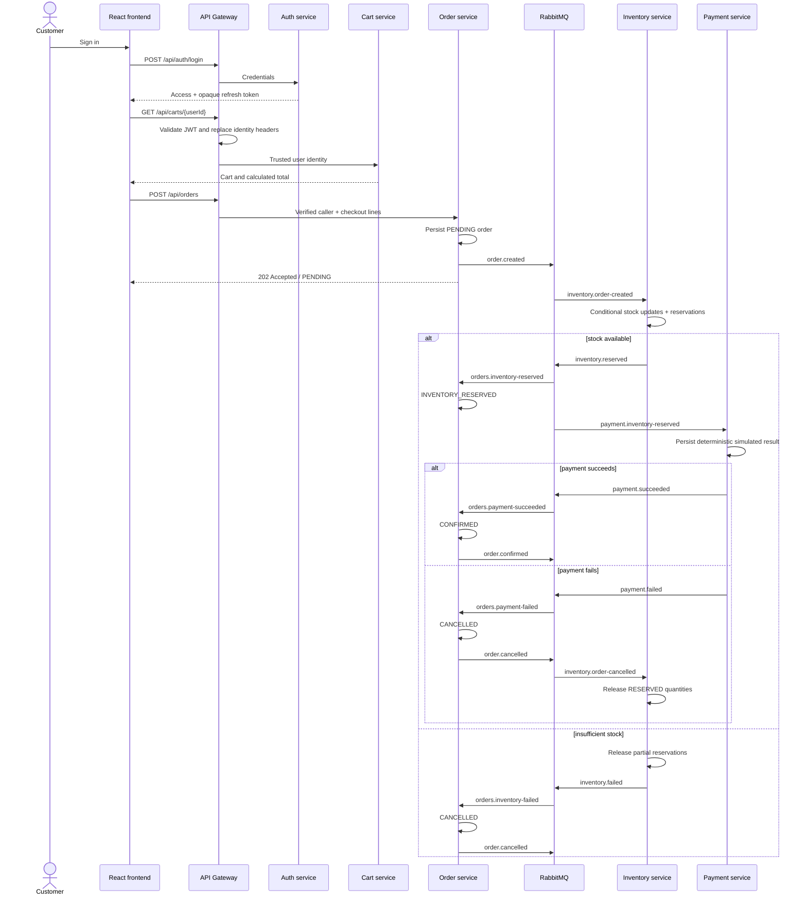
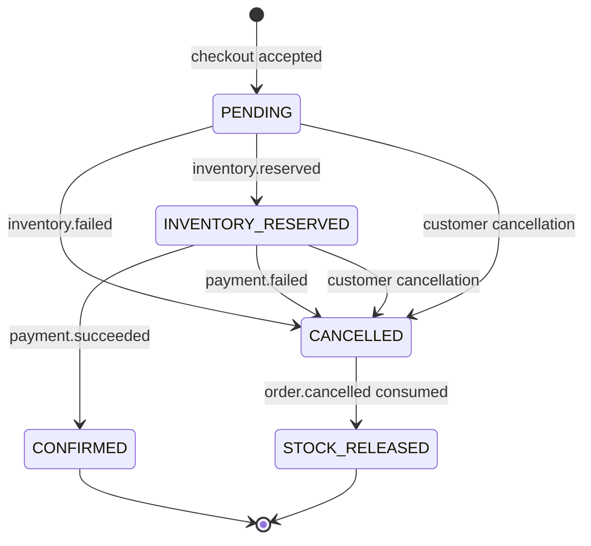
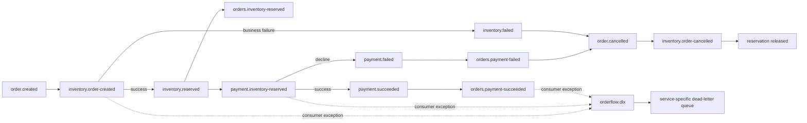
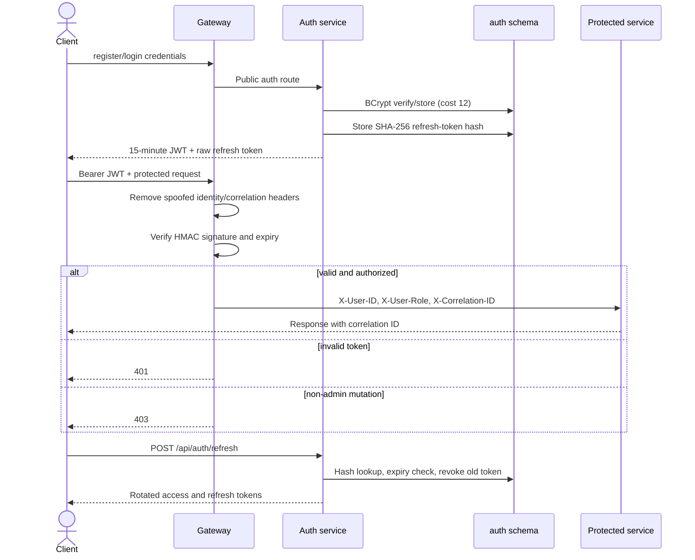

# Commerce Orchestrator

## Distributed Order Processing & Event-Driven Microservices

[](https://openjdk.org/projects/jdk/21/)
[](https://spring.io/projects/spring-boot)
[](https://www.rabbitmq.com/)
[](https://www.postgresql.org/)
[](https://react.dev/)
[](.github/workflows/ci.yml)

Commerce Orchestrator is an event-driven commerce backend that coordinates authentication, catalog access, carts, orders, atomic inventory reservations, simulated payments, and compensating recovery across independently operating services.

This is not presented as a feature-complete storefront. Its engineering focus is the difficult part behind checkout: service ownership, trusted identity propagation, asynchronous state transitions, idempotent message handling, eventual consistency, and recovery when one participant fails.

> [!IMPORTANT]
> Automated tests, the frontend build, and static Compose validation are verified. The audited machine could not start Docker Desktop's Linux engine, so the full multi-container checkout, compensation, retry, and dead-letter paths are not claimed as runtime-verified.

**Explore:** [System model](#system-model) · [Checkout protocol](#checkout-protocol) · [Failure recovery](#failure-recovery-and-idempotency) · [Services](#service-responsibility-matrix) · [API](#gateway-api-reference) · [Run locally](#local-development) · [Evidence](#verification-evidence)

---

## The engineering problem

A monolithic checkout can initially update the cart, stock, payment, and order in one process and one transaction. As the domain grows, that coupling makes independent deployment, failure isolation, schema evolution, and scaling difficult. Commerce Orchestrator separates business capabilities and gives each one explicit data ownership.

The trade-off is that one database transaction can no longer cover the whole checkout. The system accepts an order synchronously, then coordinates inventory and payment through RabbitMQ events. Each service commits its own local transaction. A failed payment produces an order cancellation; Inventory consumes that event and releases its reservation. This is a compensating Saga-style workflow—not distributed ACID and not an exactly-once messaging claim.

## System model



All client traffic is intended to enter through the Gateway. It strips caller-supplied `X-User-ID`, `X-User-Role`, and `X-Correlation-ID` headers, validates protected-route JWTs, and writes trusted identity headers for downstream services. Direct service ports are loopback-bound by Compose for diagnostics; downstream services otherwise trust the Gateway-added identity headers.

## Checkout protocol

The HTTP response means the order was accepted in `PENDING` state. Final confirmation happens asynchronously.



There is no synchronous call from Order to Inventory or Payment. Coordination crosses process boundaries through typed records in `shared-contracts` and durable topic-exchange routes.

## Failure recovery and idempotency



- Inventory uses a conditional SQL update (`available >= quantity`) so competing reservations cannot decrement below available stock at the statement level.
- Order, Inventory, and Payment persist event IDs in service-owned `processed_events` tables. A duplicate event ID returns without repeating the transition.
- Payment also has unique `order_id` and idempotency-key constraints.
- A failed payment causes Order to publish `order.cancelled`; Inventory changes matching reservations from `RESERVED` to `RELEASED` and restores counts.
- Listener retry is enabled for three attempts with rejected messages not requeued. Consumer queues declare `orderflow.dlx`; the three service DLQs bind to that exchange.
- Event publication occurs within service methods but there is no transactional outbox. A crash between database and broker effects remains a known consistency gap.



## Service responsibility matrix

| Component | Responsibility and API | Owned data | Publishes | Consumes / dependencies |
|---|---|---|---|---|
| API Gateway | Routes `/api/**`; JWT validation; ADMIN rules; identity and correlation headers | None | None | Auth, Product, Cart, Order, Inventory HTTP |
| Auth | Registration, login, refresh rotation | `auth.users`, `auth.refresh_tokens` | None | PostgreSQL; BCrypt; JWT HMAC |
| Product | Public catalog reads; ADMIN mutations | `product.categories`, `product.products` | None | PostgreSQL, Redis cache |
| Cart | Owner/admin cart reads and item changes | `cart.carts`, `cart.cart_items` | None | PostgreSQL, Redis cache |
| Order | Checkout, history, cancellation, Saga state | `orders.orders`, items, processed events | `order.created`, `order.confirmed`, `order.cancelled` | Inventory/payment result queues, PostgreSQL, RabbitMQ |
| Inventory | ADMIN stock setup; atomic reservation and release | inventory, reservations, processed events | `inventory.reserved`, `inventory.failed` | `order.created`, `order.cancelled`, PostgreSQL, RabbitMQ |
| Payment | Deterministic payment simulation and refund records | payments, refunds, processed events | `payment.succeeded`, `payment.failed` | `inventory.reserved`, `refund.initiated`, PostgreSQL, RabbitMQ |
| Frontend | Product browsing, local cart, login/refresh, checkout status | Browser tokens and component state | HTTP requests | API Gateway |

The services share one PostgreSQL server/database in Compose but own separate schemas and migrations. This is logical database-per-service ownership, not a claim of seven independently operated database servers.

## Data and cache boundaries

Flyway creates each schema’s tables and indexes while Hibernate uses `ddl-auto: validate`. Services do not write another service’s schema. Product read entries are cached for five minutes; cart views are cached for thirty minutes. Product mutations evict product data, and cart mutations evict the authenticated user’s cart entry.

Redis improves reads but is not the source of truth. Cache eviction is local to implemented mutation paths; the system does not provide cross-region or change-data-capture invalidation.

## Security model



Product mutations and all Inventory routes require `ADMIN`. Cart and Order compare requested ownership with the verified subject, allowing ADMIN override. Passwords use BCrypt cost 12. Refresh tokens are opaque, stored only as SHA-256 hashes, checked for expiry, revoked on use, and rotated. Access tokens remain valid until their 15-minute expiry; there is no denylist, TLS termination, rate limiting, or service-to-service authentication in this repository.

## Gateway API reference

Normal clients use `http://localhost:8080`.

| Method | Path | Access | Behavior |
|---|---|---|---|
| POST | `/api/auth/register` | Public | Create CUSTOMER and return token pair; 201 |
| POST | `/api/auth/login` | Public | Verify credentials and return token pair |
| POST | `/api/auth/refresh` | Public with refresh token | Revoke old token and rotate pair |
| GET | `/api/products` | Public | Active paginated products; optional `q`, `category` |
| GET | `/api/products/{id}` | Public | Product detail or 404 |
| POST | `/api/products` | ADMIN | Validate and create product; 201 |
| PUT | `/api/products/{id}` | ADMIN | Replace mutable product fields |
| DELETE | `/api/products/{id}` | ADMIN | Delete product; 204 |
| GET | `/api/carts/{userId}` | Owner or ADMIN | Calculated cart view |
| PUT | `/api/carts/{userId}/items` | Owner or ADMIN | Add or replace product line |
| DELETE | `/api/carts/{userId}/items/{productId}` | Owner or ADMIN | Remove line |
| POST | `/api/orders` | Authenticated owner or ADMIN | Persist PENDING order and return 202 |
| GET | `/api/orders?userId=` | Owner or ADMIN | Paginated order history |
| POST | `/api/orders/{id}/cancel` | Owner or ADMIN | Cancel eligible order and compensate |
| PUT | `/api/inventory/{productId}?quantity=` | ADMIN | Create/replace stock quantity |

Auth, Product, and Cart include Springdoc dependencies. With direct diagnostic ports running, their Swagger UI endpoints are `http://localhost:8081/swagger-ui.html`, `:8082/swagger-ui.html`, and `:8083/swagger-ui.html`; OpenAPI JSON is `/v3/api-docs`. See [API_DOCUMENTATION.md](API_DOCUMENTATION.md) and the [Postman collection](postman/OrderFlow.postman_collection.json).

## Frontend behavior

The React/TypeScript client fetches public products through the Gateway, displays loading/empty/error states, keeps a focused local cart, signs in, derives the JWT subject for checkout ownership, and submits an order. Protected requests retry once after a 401 by rotating the saved refresh token. Failed refresh clears both tokens. The client shows the accepted order’s immediate state; it does not poll asynchronous final payment status and it intentionally collects no card data.

## Technology choices

| Technology | Role |
|---|---|
| Java 21 | Records, mature concurrency/runtime, long-term-support baseline |
| Spring Boot 3.5 | Service composition, validation, JPA, Actuator, AMQP |
| Spring Security / JJWT | Password encoding and signed access-token boundary |
| PostgreSQL 17 / Flyway | Transactional service schemas and versioned migrations |
| RabbitMQ 4 | Durable topic routing, asynchronous Saga events, DLX topology |
| Redis 7 | Bounded product/cart read caches with LRU memory policy |
| React 19 / TypeScript 5 | Typed demonstration client and auth retry flow |
| Docker Compose | Reproducible local topology and dependency health ordering |

## Local development

### Requirements

- JDK 21 and Maven 3.9+
- Node.js 22+ and npm
- Docker Desktop/Engine with Linux containers and Compose
- About 3 GB free memory for the complete local stack

Windows PowerShell tool checks:

```powershell
java -version
mvn -version
node --version
npm --version
docker version
docker compose version
```

Create local configuration:

```powershell
Copy-Item .env.example .env
# Replace the development password and JWT secret in .env.
```

Build the sources:

```powershell
mvn clean test
Push-Location frontend
npm ci
npm run build
Pop-Location
docker compose config --quiet
```

Start the full topology in dependency order:

```powershell
docker compose up --build --wait
docker compose ps
curl.exe http://localhost:8080/actuator/health
```

Frontend: `http://localhost:3000`  
Gateway: `http://localhost:8080`  
RabbitMQ management: `http://localhost:15672`

On an 8 GB machine, infrastructure can be started separately while services run from an IDE:

```powershell
docker compose up -d postgres redis rabbitmq
```

Stop without deleting data using `docker compose down`. Use `docker compose down -v` only when intentionally deleting the PostgreSQL volume.

### Configuration

| Variable | Example/default | Purpose |
|---|---|---|
| `POSTGRES_DB` | `orderflow` | Compose database name |
| `POSTGRES_USER` | `orderflow` | Local database account |
| `POSTGRES_PASSWORD` | `change-me` | Local password; replace outside demonstration use |
| `JWT_SECRET` | 32+ character placeholder | Shared HMAC key for Auth and Gateway |
| `PAYMENT_FAILURE_RATE` | `0.10` | Deterministic simulated decline ratio from 0 to 1 |
| `SPRING_DATASOURCE_URL` | service YAML default uses localhost | JDBC URL; Compose overrides host to `postgres` |
| `SPRING_DATASOURCE_USERNAME` | `orderflow` | Service JDBC username |
| `SPRING_DATASOURCE_PASSWORD` | `orderflow` | Service JDBC password |
| `SPRING_RABBITMQ_HOST` | `localhost` | Broker host; Compose uses `rabbitmq` |
| `SPRING_DATA_REDIS_HOST` | `localhost` | Cache host; Compose uses `redis` |
| `SERVER_PORT` | service-specific | Compose health-check port |
| `VITE_API_URL` | `/api` | Frontend API base; Nginx proxies it to Gateway |

Only the first five are present in `.env.example`; the remaining values are service-level overrides defined in YAML/Compose. Do not commit `.env`.

## Verification evidence

Evidence from [FINAL_ENGINEERING_AUDIT.md](FINAL_ENGINEERING_AUDIT.md) and [FINAL_RUNTIME_VERIFICATION.md](FINAL_RUNTIME_VERIFICATION.md):

| Check | Result | Boundary |
|---|---|---|
| Maven reactor `test` | **15 passed, 0 failed** | Nine modules using cached dependencies |
| Exact `mvn clean test` | **Environment-blocked** | Uncached clean plugin could not resolve because host DNS failed |
| Frontend strict build | **Passed** | TypeScript and Vite, 28 modules in recorded run |
| Production npm audit | **0 known vulnerabilities** | At recorded audit time |
| Compose configuration | **Passed** | Static configuration only |
| Docker Linux engine | **Unavailable** | Named pipe did not initialize after Docker Desktop launch |
| Full checkout / compensation / DLQ | **Not executed** | No live multi-service claim |
| Performance | **Not measured** | No throughput or latency values claimed |

Tests cover credential failure, refresh replay, malformed input, Gateway 401/403 and header replacement, insufficient inventory, release behavior, duplicate inventory/payment events, payment failure, amount propagation, and consumer exception propagation. They are not substitutes for live PostgreSQL/RabbitMQ concurrency, retry, or DLQ verification.

## Operations and diagnostics

Every application enables graceful shutdown and Actuator health/info. Compose waits for PostgreSQL and RabbitMQ health, and the Gateway waits for every application service. Product and Cart also depend on Redis readiness. The Gateway returns or creates `X-Correlation-ID`, but downstream logging does not yet implement a complete structured correlation pipeline. Direct service ports bind to `127.0.0.1`; only Gateway, frontend, and infrastructure ports are broadly published for local use.

## Design trade-offs

- **Async checkout:** isolates downstream processing but exposes eventual rather than immediate final state.
- **Owned schemas:** reduces accidental cross-service writes while still sharing one operational PostgreSQL instance.
- **Compensation:** avoids distributed two-phase commit, but intermediate states and recovery logic are visible.
- **Idempotent consumers:** make duplicate event IDs harmless, but do not close the database/broker atomicity gap.
- **Redis caches:** reduce read load while requiring explicit eviction on mutations.
- **Refresh rotation:** limits replay of a used refresh token, while access JWTs remain stateless until expiry.

## Known limitations

- Payment processing is deterministic simulation, not a payment-provider integration.
- The complete Docker topology and end-to-end Saga were not runtime-verified on the audited machine.
- No production deployment, availability target, or measured throughput/latency is claimed.
- No transactional outbox/inbox closes local commit versus event-publication failures.
- Internal services trust Gateway identity headers and lack mutual service authentication.
- The frontend does not persist carts to Cart Service or poll final order status.
- Listener concurrency, PostgreSQL reservation contention, retry exhaustion, and actual DLQ movement remain unverified live.
- There is no distributed tracing backend, centralized logs, metrics dashboard, rate limiting, or access-token revocation.

## Engineering roadmap

Future work—not existing functionality:

1. Add an outbox/inbox pattern and broker publisher confirmation.
2. Add Testcontainers contract and concurrency tests for PostgreSQL, Redis, and RabbitMQ.
3. Introduce OpenTelemetry traces, structured logs, metrics, and alerting.
4. Integrate a sandbox payment provider with webhook idempotency.
5. Add consumer-driven contracts and schema compatibility checks.
6. Run controlled failure injection and retry/DLQ recovery exercises.
7. Record reproducible load tests with requests, concurrency, p50/p95/p99, throughput, and error rate.
8. Consider Kubernetes only after runtime behavior and resource requirements are measured.

## Repository map

```text
commerce-orchestrator/
├── api-gateway/          JWT, authorization, routing, correlation IDs
├── auth-service/         Users, BCrypt credentials, rotating refresh tokens
├── product-service/      Catalog CRUD/search and Redis cache
├── cart-service/         Owner-scoped carts and Redis cache
├── order-service/        Checkout, order state, Saga coordination
├── inventory-service/    Atomic stock reservation and compensation
├── payment-service/      Simulated payments and refunds
├── shared-contracts/     Typed RabbitMQ event records
├── frontend/             React/TypeScript demonstration client
├── docker/               Shared service image and schema bootstrap
├── postman/              Importable request collection
├── scripts/              Parameterized PowerShell load-test utility
├── .github/workflows/    Maven and frontend CI
└── docker-compose.yml    Complete local topology
```

Further reading: [Architecture](ARCHITECTURE.md) · [API](API_DOCUMENTATION.md) · [Checkout](CHECKOUT_FLOW.md) · [Database design](DATABASE_DESIGN.md) · [Demo](DEMO.md) · [Interview guide](INTERVIEW_GUIDE.md) · [Engineering audit](FINAL_ENGINEERING_AUDIT.md) · [Runtime verification](FINAL_RUNTIME_VERIFICATION.md)

## Developer

### Shivansh Kumar

**Software Engineer | Backend Engineering | Distributed Systems**

- Portfolio: [shivanshonline.in](https://shivanshonline.in)
- GitHub: [github.com/shivansh07adi-cloud](https://github.com/shivansh07adi-cloud)
